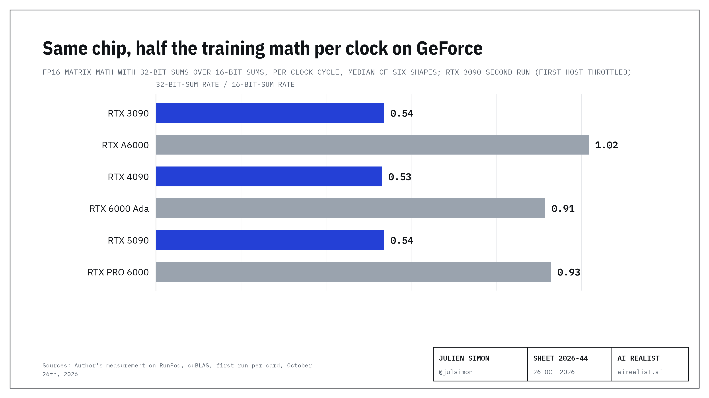

# GeForce half rate: FP16 matrix math with 32-bit sums, measured

NVIDIA's whitepapers rate GeForce cards at half speed for FP16 and BF16 tensor math with FP32 accumulation, the mode mixed-precision training uses, while the professional cards built on the same chips run both modes at the same rate. This repository measures that on stock cards rented on RunPod, on October 26th, 2026.



## Results

Per clock cycle, the three GeForce cards ran 32-bit sums at 0.51 to 0.59 of their 16-bit speed; the professional cards on the same chips ran them at 0.85 to 1.06. The two groups do not overlap. Delivered FP16 TFLOPS with 32-bit sums, lowest and highest of six shapes:

| Chip | Card | Runs | Delivered TFLOPS | Power limit |
|---|---|---|---|---|
| GA102 | RTX 3090 | 2 | 57.7 to 74.1 (first host throttled) | 350 W |
| GA102 | RTX A6000 | 2 | 105.3 to 120.8 | 300 W |
| AD102 | RTX 4090 | 2 | 145.0 to 163.1 | 450 W |
| AD102 | RTX 6000 Ada | 2 | 93.3 to 127.1 | 300 W |
| GB202 | RTX 5090 | 1 | 206.1 to 220.5 | 575 W |
| GB202 | RTX PRO 6000 Blackwell | 1 | per-clock only (host capped a 600 W card at 390 W) | 390 W |

The full write-up, including the replication runs and the limits, is in [FINDINGS.md](FINDINGS.md). Raw data: `results/<UTC>_<GPU>/` holds `gemm.csv` (one row per mode and shape), `telemetry.csv` (clocks, power, temperature every 0.5 s), `gpu.csv`, `nvidia-smi-q.txt` and `nvcc.txt`.

## Method

- `run.sh` writes and compiles a cuBLAS benchmark (`cublasGemmEx`) and runs it in five modes: FP16 with FP16 accumulation, FP16 with FP32 accumulation, BF16 with FP32, TF32, INT8 with INT32 as a control. Six shapes: three square (4,096, 8,192, 16,384) and three from a Llama-3.1-8B prefill at 4,096 tokens. Random input data, about 2 seconds per trial, median of three trials, a 3-second idle gap between configurations.
- `analyze.py` joins each configuration to its telemetry segment and prints raw and per-clock ratios. Per clock means TFLOPS divided by the median SM clock during the run; this normalization was chosen after seeing that the cards sat at their power limits.
- `pod.py` creates a RunPod pod, copies `run.sh`, runs it over SSH, copies `results/` back and terminates the pod. It reads a RunPod API key from the macOS Keychain item `runpod-api-key` and uses the SSH key `~/.ssh/julien-runpod`; change both for your own account.

## Reproduce

```bash
python3 -m venv .venv && .venv/bin/pip install runpod==1.12.0
.venv/bin/python pod.py "NVIDIA GeForce RTX 4090"
python3 analyze.py results/<run folder>
```

Use a CUDA 12.8 image for Blackwell cards (edit `IMAGE` in `pod.py`). Each run takes 10 to 20 minutes of pod time.

## Limits

These are matrix multiplications, not whole training jobs. One host per run, unknown cooling; two cards ran once. A RunPod pod is a container, so this measures the half rate on stock cards; it cannot load the kernel modules that lift it.

## License

MIT. Data and text: CC BY 4.0.
